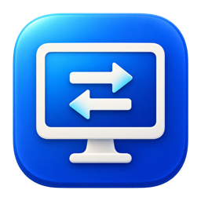
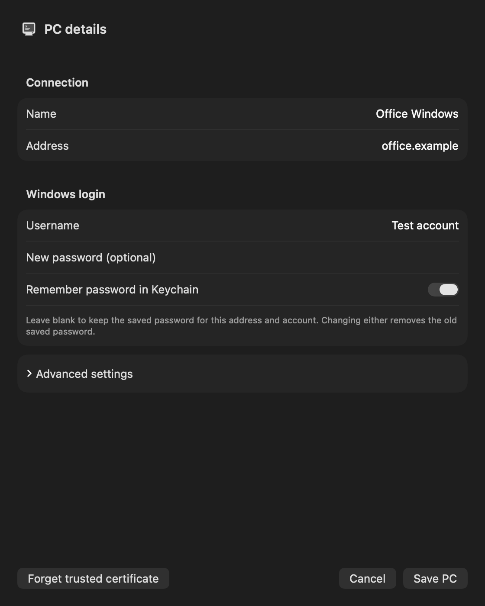
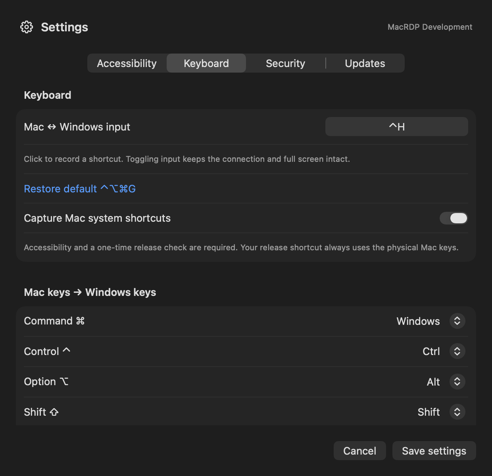

<p align="center">
  
</p>

# MacRDP

**A native Mac app for connecting to your Windows desktop.**

MacRDP brings saved PCs, Retina display support, and configurable keyboard controls to a SwiftUI/AppKit interface powered by FreeRDP 3. Switch control between Mac and Windows without disconnecting, work in full screen, and keep your Windows passwords in macOS Keychain.

**Current app target:** Apple Silicon · macOS 27.0 or later · one remote session and one monitor at a time.

[Get started](#get-started) · [Features](#features) · [Keyboard and session controls](#keyboard-and-session-controls) · [Build from source](#build-from-source) · [Verification](#verification)

## Features

| Feature | What you can do |
| --- | --- |
| Saved PCs | Add, edit, and delete connections with a hostname or IP address, account, and per-PC display preferences. |
| Secure sign-in | Optionally remember Windows passwords in Keychain. Protect access to the app with a 4–12 digit PIN. |
| Retina display | Request a desktop at the view’s backing resolution, choose Windows UI scaling, and resize dynamically when the server supports it. |
| Full screen | Open Windows in a dedicated session window with compact controls and a Mac/Windows input toggle. |
| Keyboard and mouse | Send typing, clicks, dragging, and scrolling. Customize the input-toggle shortcut and Command, Control, Option, and Shift mappings. |
| Familiar copy and paste keys | Use the **Command copies & pastes** preset to send Command as Windows Ctrl. This remaps keys; it does not synchronize the Mac and Windows clipboards. |
| Windows desktop navigation | Use Previous/Next desktop buttons or configurable three-/four-finger gestures. Gesture delivery depends on macOS settings. |
| Menu-bar access | Show the app or session, connect to a saved PC, switch input control, disconnect, lock, and open Settings. |
| Certificate verification | Review an untrusted PC’s certificate and fingerprint, then trust it once or remember that specific host. Changed fingerprints require a new decision. |
| In-app updates | Check for updates, see progress, and install signed updates from **Settings → Updates**, powered by Sparkle. |

System-shortcut capture and trackpad gestures are implemented, but physical acceptance testing remains outstanding. See [current limitations](#current-limitations).

## Interface preview

Native UI previews rendered from the app’s test fixtures with synthetic account details. These are not screenshots of a live Windows session. The keyboard preview shows an example custom shortcut; the default is **⌃⌥⌘G**.

<table>
  <tr>
    <th>PC details</th>
    <th>Keyboard settings</th>
  </tr>
  <tr>
    <td></td>
    <td></td>
  </tr>
</table>

## Get started

You need a reachable Windows PC with Remote Desktop enabled and a Windows account allowed to connect. Connect your VPN first if the PC is on a private network.

1. **Install or build MacRDP.** If you have a packaged DMG, open it and drag MacRDP into Applications. For a development build, follow [Build from source](#build-from-source).
2. **Set up your app PIN.** Create a 4–12 digit PIN on first launch, or unlock with your existing PIN.
3. **Add your PC.** Choose **Add PC**, enter its address and Windows account details, and optionally enable **Remember password in Keychain**. Use your Windows account password, not your Windows Hello PIN.
4. **Choose display options.** Expand **Advanced settings** for Retina optimization, Windows UI scale, and initial full screen. Retina is enabled by default.
5. **Connect.** Select the saved PC and choose **Connect**. If its certificate cannot be verified automatically, check its fingerprint before choosing to trust it.
6. **Switch control when needed.** Press **Control + Option + Command + G** (**⌃⌥⌘G**) or use the session’s Mac/Windows control.

Packaged builds bundle the native libraries. The app is locally signed and **not notarized**; macOS may require first-launch approval in Privacy & Security. Packaging and signing details are in the [release guide](docs/RELEASING.md).

## Keyboard and session controls

Ordinary typing and pointer input work without Accessibility permission. To capture Mac system shortcuts, enable **Capture Mac system shortcuts** under **Settings → Keyboard**, then complete the permission and release checks under **Settings → Accessibility**. The first capture test has a ten-second safety limit. The status control tells you whether capture is actually active.

The default modifier mapping is:

| Mac key | Windows key |
| --- | --- |
| Command ⌘ | Windows |
| Control ⌃ | Ctrl |
| Option ⌥ | Alt |
| Shift ⇧ | Shift |

Change these individually in **Settings → Keyboard**, or choose **Command copies & pastes**. The release shortcut always uses the physical Mac keys, regardless of your mappings. macOS Force Quit remains available.

| Action | What happens to the session |
| --- | --- |
| Switch to Mac input | Releases remote input; the connection and full screen stay open. |
| Switch to another app or Mac desktop | Releases input temporarily. Returning to the session restores the preferred Windows mode when eligible. Explicit Mac mode stays selected. |
| Lock MacRDP | Releases input and hides access behind the PIN; an established connection stays open. |
| Close the main PC-list window | Hides the workspace to the menu bar. |
| Close the Windows session window or choose Disconnect | Ends the RDP connection and returns to the workspace. |
| Quit MacRDP | Releases input and ends the connection. |

Three-finger gestures default to switching Windows desktops; four-finger gestures default to releasing input for Mac desktop navigation. Both mappings are configurable. macOS may consume a gesture before MacRDP receives it. Use the session’s Previous/Next desktop buttons as an alternative; Windows needs more than one virtual desktop.

## Current limitations

- **Scope:** one session and one remote monitor. Clipboard synchronization, audio, RD Gateway, RemoteApp, and device/file redirection are not implemented.
- **Compatibility:** the current native app and bundled libraries require Apple Silicon and macOS 27.0+. The standalone Swift core’s macOS 14 target does not imply app support for older systems.
- **Manual acceptance:** physical system-shortcut capture, trackpad routing, and real-Windows Retina sharpness, scaling, and pointer alignment still need verification on the target hardware.
- **Performance:** the current Homebrew FreeRDP build uses software decoding. Hardware decoding and performance parity with Microsoft Windows App have not been established.
- **Updates:** signed update handling is implemented; a complete live replacement and relaunch between published versions remains a manual acceptance check.

## Build from source

The current development setup uses Xcode 27 / Swift 6.4, Apple Silicon Homebrew, FreeRDP/WinPR **3.32.2**, and Sparkle **2.10.0**. Development builds link libraries from `/opt/homebrew`.

Install the dependencies and check the environment:

```sh
./scripts/bootstrap.sh
```

Building also requires the project’s original signing identity in your login Keychain and the pinned credential helper. See the [signing setup](docs/RELEASING.md#signing) before building on another Mac; the scripts deliberately fail if that private key is unavailable.

```sh
./scripts/build-app.sh
open build/app/Build/Products/Debug/MacRDP.app
```

For an optimized build:

```sh
MACRDP_CONFIGURATION=Release ./scripts/build-app.sh
```

`MacRDP.xcodeproj` builds the application. CMake builds only the separate dependency probe. `Brewfile` is not an immutable lock; recorded dependency versions are in [dependencies.json](docs/research/dependencies.json).

## Verification

Run the checks relevant to your change:

```sh
./scripts/doctor.sh             # Environment and dependencies
./scripts/build-probe.sh        # Native library linking
./scripts/test.sh               # Swift core behavior
./scripts/test-input-queue.sh   # Input ordering and release cleanup
./scripts/test-native.sh        # Native UI and app lifecycle
./scripts/test-rdp.sh           # Localhost RDP integration
```

The RDP suite uses a temporary local FreeRDP peer, disposable certificates, and synthetic credentials. It covers TLS/NLA authentication, certificate rejection and pinning, desktop pixels, dynamic resize, keyboard/mouse delivery, and held-input cleanup. It does not establish successful login or visual quality on a real Windows PC. Restricted environments may require permission to bind a localhost socket.

If the compiler cannot start its nested plugin sandbox, the build script accepts `'OTHER_SWIFT_FLAGS=$(inherited) -disable-sandbox'`. This affects compiler plugins, not the app’s macOS permissions.

## Project guide

| Location | Purpose |
| --- | --- |
| [Sources/MacRDP](Sources/MacRDP) | SwiftUI/AppKit interface, session windows, rendering, and keyboard capture |
| [Sources/RDPBridge](Sources/RDPBridge) | Thin C bridge to FreeRDP, which owns the RDP protocol |
| [Sources/CaptureCore](Sources/CaptureCore) | Profiles, display geometry, input state, gestures, and PIN/Keychain logic |
| [Tests](Tests) | Behavioral, native, signing, and RDP integration checks |

- [Setup status and change history](docs/SETUP-STATUS.md) — recorded implementation and verification results.
- [Client guide](docs/CLIENT.md) — architecture and detailed behavior, including historical implementation notes.
- [Product requirements](docs/REQUIREMENTS.md) and [development handoff](START-HERE.md).
- [Keyboard acceptance plan](docs/KEYBOARD-TEST-PLAN.md), [Retina acceptance plan](docs/RETINA-DISPLAY.md), and [performance procedure](docs/PERFORMANCE.md).
- [Release guide](docs/RELEASING.md) — signing, packaging, and updates.
